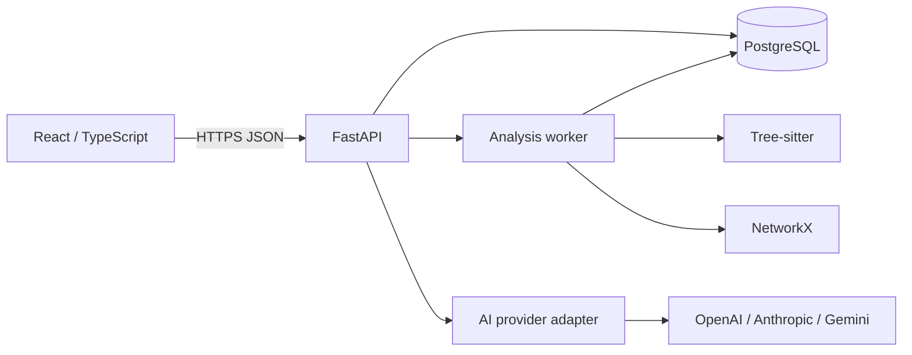

# DevTrace Architecture

**Status:** Phase 0 architectural source of truth; Phase 1 foundation is implemented
**Last updated:** 2026-11-08

## System boundary

DevTrace converts a pinned repository revision into queryable files, symbols, dependencies,
graph relationships, diagnostics, and selected static execution flows. Users create
projects, run analysis, explore immutable snapshots, and ask grounded AI questions.

The initial system is a modular monolith: React browser client, FastAPI API, PostgreSQL,
and bounded analysis-worker processes. PostgreSQL is the product system of record and the
initial graph store. Do not add microservices, a graph database, message broker, vector
database, or cache until measured requirements justify one.

## Responsibilities

| Component | Owns | Does not own |
| --- | --- | --- |
| React frontend | Routing, interaction state, API lifecycle, React Flow rendering/layout | Parsing, trusted graph data, authorization |
| FastAPI | Validation, auth, resource authorization, transactions, response contracts | Long-running parsing in request threads |
| Worker | Safe content preparation, parsing, extraction, graph construction, diagnostics | Browser/session policy |
| PostgreSQL | Product data, jobs, immutable artifacts, graph rows, audit/AI records | Unbounded raw source archive storage |
| AI adapter | Provider-neutral calls and normalized result/usage | Database access or ungrounded repository access |

Frontend uses feature modules: `app`, `features` (auth/projects/analysis/explorer/ai),
`components`, `lib`, and `types`. React Router owns URL state. React Flow consumes a
server-filtered projection and owns only visual state. Axios is sufficient initially;
introduce a query cache only when invalidation complexity proves it necessary.

Backend modules are `api`, `core`, `models`, `repositories`, `services`, `analysis`, `ai`,
and `workers`. Routes handle transport; services own use cases/authorization; analysis
does not import HTTP code. Pydantic contracts and ORM models remain separate.

## Analysis pipeline

1. An editor creates an analysis run for a repository source and ref.
2. The API persists a `queued` run/job and returns immediately.
3. A worker claims a lease, pins commit SHA/content digest, and enforces limits.
4. Tree-sitter parses supported files; language extractors emit files, symbols, links, and diagnostics.
5. The resolver links only evidence-backed references; unresolved/ambiguous facts remain explicit.
6. NetworkX validates a directed multigraph and calculates bounded metrics.
7. The worker persists artifacts and marks the run `completed`, `failed`, or `cancelled`.

Completed analysis runs are immutable. Re-analysis creates a new run, making graph links,
AI citations, debugging, and future comparisons reproducible.

Rules: never execute repository code, hooks, build scripts, or package managers; deny VCS
metadata, binaries, dependencies, generated output, oversized files, and likely-secret
paths by default; record parser errors as diagnostics where possible; record provenance,
source span, extractor version, and confidence. Ship one chosen language first
(TypeScript/JavaScript recommended) with fixture tests. Unsupported content is reported,
never implied to be fully analyzed.

## Graph model

For each run, build `G = (V, E)` as a `networkx.MultiDiGraph`. Nodes represent repository,
directory, file, module, class, interface, function, method, export, endpoint, dependency,
or unresolved entity. Edges are directional and carry a relationship kind, confidence,
evidence span, and bounded metadata.

Initial relationships are `contains`, `defines`, `imports`, `exports`, `extends`,
`implements`, `calls`, `references`, `uses_type`, `routes_to`, and `depends_on`. Adding a
kind requires extractor, migration, API, and test changes. Persist normalized `graph_nodes`
and `graph_edges` scoped to the run; JSONB is only sparse language-specific metadata.
PostgreSQL supports bounded traversal. The API creates React Flow DTOs, so UI state is never
the canonical graph. Node fingerprints are deterministic within a run; UUIDs are opaque
public identifiers.

## AI grounding

An internal `LLMProvider` interface normalizes completion requests/results: text, provider,
model, provider request ID where available, usage, and finish reason. OpenAI, Anthropic,
and Gemini adapters sit behind it. Provider selection is deployment configuration.

AI is snapshot-scoped: verify membership and completed run; retrieve selected nodes plus a
capped graph neighborhood/diagnostics; include only necessary source excerpts with paths
and spans; cap files/nodes/edges/characters/prompt/output/time; require citations and
uncertainty; record safe conversation/usage metadata. First capability is explanatory Q&A
only. AI cannot mutate source, analysis, configuration, or authorization. Embedding/vector
retrieval is deferred because graph neighborhood plus source spans meets the first need.

## API, authentication, and authorization

The frontend calls versioned `/api/v1` HTTPS JSON endpoints with Pydantic schemas, UTC
RFC 3339 dates, UUIDs, cursor pagination, request IDs, idempotency keys where needed, and
problem-details errors. Analysis is asynchronous and initially polled; add SSE only after
need is measured. See `API_DESIGN.md` for contract details.

Passwords use Argon2id. Login returns a short-lived signed JWT access token held only in
memory, and sets a rotated opaque refresh token cookie. Refresh tokens are server-hashed,
`HttpOnly`, `Secure`, `SameSite`, and refresh-path scoped. JWT claims are minimal: user ID,
session ID, issuer/audience, token type, issued/expiry. Logout revokes the current session;
password change/account disable revoke all. Every project/run/file/graph/source/AI action
has service-layer resource membership enforcement.

| Role | Configure project | Start/cancel analysis | Read/ask AI | Manage members |
| --- | --- | --- | --- | --- |
| Owner | Yes | Yes | Yes | Yes |
| Editor | Yes | Yes | Yes | No |
| Viewer | No | No | Yes | No |

## Security and scaling

- Enforce TLS/HSTS in deployment, strict CORS, security headers, CSRF for cookie-bearing
  endpoints, parameterized queries, validation, generic safe errors, and rate limits.
- Treat repositories as hostile: unprivileged isolated workers, no execution, parser/job/
  graph/database limits. Validate repository URLs and block SSRF to private/link-local/
  metadata networks, unsafe redirects, and unsafe protocols.
- Exclude/redact probable secrets as defense-in-depth; store no plaintext passwords,
  refresh tokens, repository credentials, or provider keys. Audit security-relevant actions.
- Jobs are durable rows claimed with `FOR UPDATE SKIP LOCKED` leases. APIs scale
  horizontally from PostgreSQL; add a broker only for observed contention.
- Index memberships, runs, jobs, paths, node kinds, and edge endpoints/types. Enforce
  graph projection bounds. Cache immutable run projections only after profiling. Add safe
  structured logs, metrics, traces, backups/PITR, health checks, and graceful shutdown.

## Implementation invariants

1. Preserve immutable completed runs.
2. Every schema change has an Alembic migration; do not use production ORM auto-creation.
3. Test endpoints, security branches, extractors/resolvers, graph queries, and UI features
   in the phase that introduces them.
4. Add dependencies only when the approved stack cannot meet a documented requirement.
