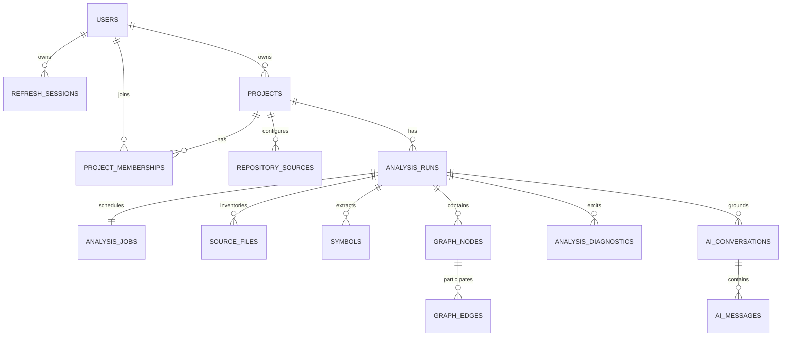

# DevTrace Database Design

**Database:** PostgreSQL 15+
**Access/migrations:** SQLAlchemy 2.x and Alembic

## Data rules

- PostgreSQL is authoritative for product and analysis state.
- Use UUID primary keys, UTC `timestamptz`, explicit foreign keys, and normalized tables.
- Completed analysis artifacts are immutable. JSONB is only bounded sparse metadata, never
  query-critical graph structure or opaque data dumps.
- Deletion is restrictive by default; project/source deletion needs an explicit retention
  workflow rather than an accidental cascade.

## Core tables

| Table | Purpose and essential fields |
| --- | --- |
| `users` | ID, normalized unique email, password hash, display name, active flag, timestamps |
| `refresh_sessions` | ID, user ID, unique token hash, expiry/revocation/rotation, bounded device/IP metadata |
| `projects` | ID, owner ID, name, slug, description, archive/timestamps; unique owner+slug |
| `project_memberships` | Project/user IDs, role, created timestamp; unique project+user |
| `repository_sources` | Project ID, source type, canonical URL, default ref, active state; no plaintext credential |
| `analysis_runs` | Project/source/requester IDs, status, commit SHA/content digest, analyzer version, counts, times, safe failure fields |
| `analysis_jobs` | Unique run ID, state, attempts, lease owner/expiry, availability/start/finish/cancel/error fields |
| `source_files` | Run ID, normalized path, language, digest, byte/line count, parse status/error; unique run+path |
| `symbols` | Run/file IDs, kind/name/qualified name/visibility, span, fingerprint, metadata |
| `graph_nodes` | Run/symbol/file IDs, kind/label/qualified name/fingerprint, metadata |
| `graph_edges` | Run/source/target node IDs, relationship, confidence, evidence span, metadata |
| `analysis_diagnostics` | Run/file IDs, severity, code, message, location, metadata |
| `ai_conversations` | Project/run/creator IDs, title, timestamps |
| `ai_messages` | Conversation ID, role/content, citations, provider/model/usage/status/timestamps |
| `audit_events` | Actor/project IDs, event/target fields, request ID, safe details, timestamp |

## Job and run lifecycle

`analysis_runs.status` is `queued`, `running`, `completed`, `failed`, or `cancelled`.
Allowed transitions: `queued -> running -> completed|failed|cancelled`, or `queued ->
cancelled`. User cancellation requests it; workers commit terminal status only at safe
checkpoints. A completed run has a commit SHA or content digest.

`analysis_jobs` isolates retry/lease mechanics. Workers claim rows via `FOR UPDATE SKIP
LOCKED`, set a lease, and may only finalize their lease. Retries are bounded and stale
leases can be reclaimed safely.

## Graph representation and integrity

`symbols` is the extractor semantic inventory. `graph_nodes` is the unified explorer
inventory; files/directories/dependencies can be nodes without being symbols. Edges form a
run-scoped directed multigraph. A null target is allowed only for a marked unresolved
reference. Resolved endpoints must be in the same run; enforce this in the persistence
layer initially, adding composite foreign keys if later needed.

Each edge has controlled relation kind, confidence in `[0,1]`, optional evidence location,
and bounded metadata. Fingerprints are deterministic and indexed within each run, helping
cross-run matching but never acting as global identity.

## Indexes and constraints

- Membership: unique `(project_id, user_id)` and `(user_id, project_id)` lookup index.
- Runs: `(project_id, created_at DESC)` and `(project_id, status)`.
- Jobs: unique run ID, claimable-state partial index ordered by availability, lease-expiry index.
- Files: unique `(analysis_run_id, normalized_path)` and run/language index.
- Symbols/nodes: run plus file, kind, qualified name, and fingerprint indexes.
- Edges: run/source, run/target, and run/relation-kind indexes.
- Diagnostics: run/severity and file/severity; audit: project/time, actor/time, request ID.
- Check constraints cover confidence, nonnegative sizes/counts, valid spans, and time order.

## Sensitive data and migrations

Never store plaintext passwords, refresh tokens, repository credentials, or provider keys.
Store refresh hashes. Future repository secrets require deployment-key encryption and a
dedicated secret abstraction; initial sources should need no stored secret.

Store source metadata/spans first. Durable raw source/excerpts are deferred until
encryption, redaction, retention, deletion/export, and object-storage policy are approved.
AI messages are project data and follow retention/deletion policy.

Every schema change uses reviewed Alembic migrations. Add nullable columns before requiring
them for populated data; separate large backfills from locking DDL; maintain rolling
application/migration compatibility. No Neo4j, vector store, Redis schema, or blob store
exists in Phase 0.
